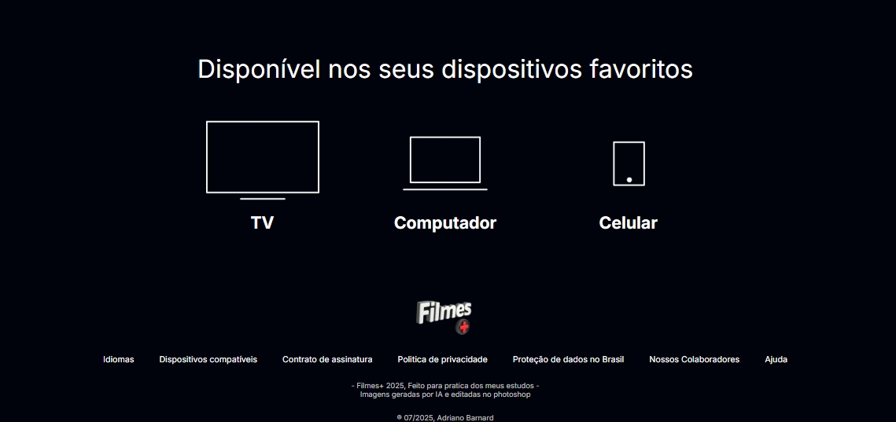
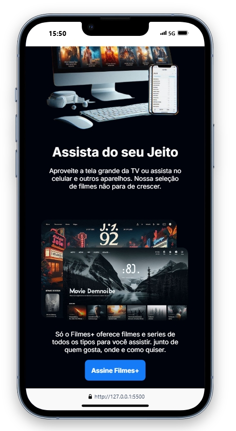

# 🎬 Site Movies 07/2025

Homepage of a movie website.

## 📚 About the Project

- **My second project.**
  
The goal of this project was to put into practice what I've learned so far.

I decided to try creating a responsive website, adapted for different screen sizes and devices.

The homepage of a movie website, such as (Netflix, Amazon, and others).

All images used were generated by AI and subsequently altered in Photoshop.

## 🛠️ Tecnologias Utilizadas

- HTML5  
- CSS3

## 📌 imagens

 

 

[Visualizar o Site](https://site-filmes-plum.vercel.app/)

