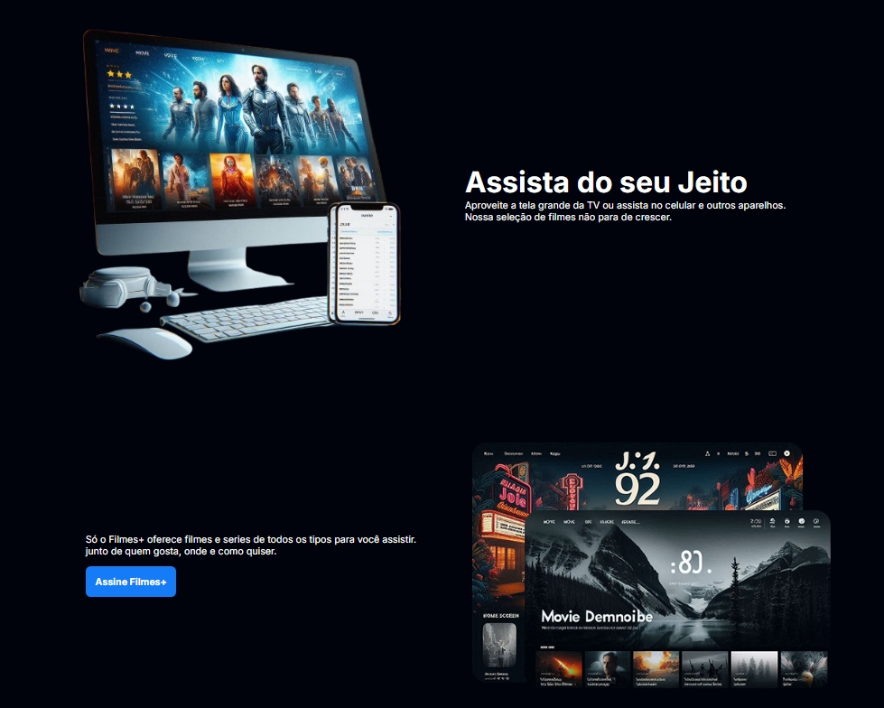
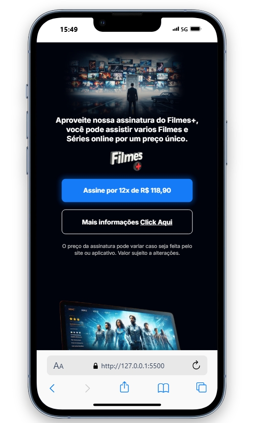
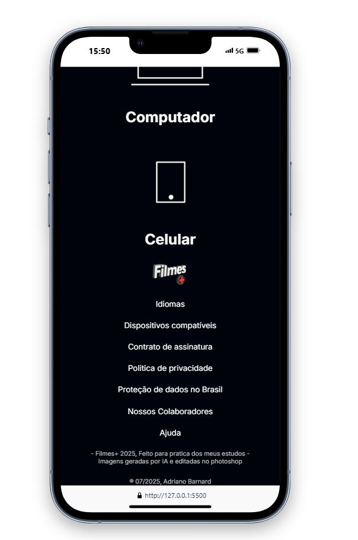

# 🎬 Filmes+ (07/2025)

Página inicial responsiva de um serviço fictício de streaming de filmes e séries.

## 📚 Sobre o Projeto

- **Segundo projeto prático.**

O objetivo deste projeto foi colocar em prática os conhecimentos adquiridos em HTML5 e CSS3, criando uma landing page responsiva adaptada para diferentes tamanhos de tela e dispositivos (desktop, tablet e celular), inspirada em serviços como Netflix e Prime Video.

Todas as imagens utilizadas foram geradas por IA e posteriormente editadas no Photoshop.

## 🛠️ Tecnologias Utilizadas

- HTML5
- CSS3

## 📌 Capturas de Tela

[Visualizar o Site](https://site-filmes-plum.vercel.app/)
